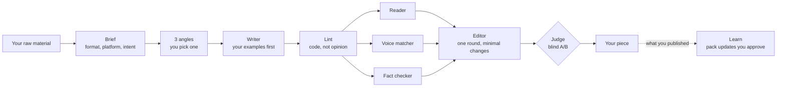

# Plume

**Writes like you. Reads like your audience.**

A writing assistant skill for people who publish under their own name. Plume drafts, edits, repurposes and reviews LinkedIn posts, articles, emails, messages, bios and more, in your voice. Then it checks the result with critics that each lack something the writer has, so the problems a stranger would notice get caught before you publish.

> [!IMPORTANT]
> Plume is only as good as your voice pack: your voice, your bans, your audiences, your facts and, above all, pieces you actually published. Run `setup` first. Three published pieces are enough to start; Plume asks for more as you go.

## What it does

- **Writes** a piece from your raw material (something you lived, saw or measured), in your voice
- **Edits** your own draft with minimal changes, without smoothing your style
- **Repurposes** one source into several formats (an article into a LinkedIn post and a carousel)
- **Reviews** a text and gives prioritised findings, without rewriting
- **Checks for repetition:** if you already published on the same subject, it says so and asks for a new angle or a follow-up
- **Learns** from what you actually published: it compares its draft with your final version and proposes updates to your pack, which you approve one by one
- **Sets up** your voice pack: it extracts your voice from pieces you published, asks at most five questions for what it can't extract, and imports the voice bible or business data you already have

## What it doesn't do

- **Invent.** No made-up figures, clients, results, quotes or links. Missing facts become placeholders for you to fill.
- **Write without material.** If there's nothing concrete to work with, Plume asks up to three questions instead of filling the gap.
- **Change your voice per platform.** Formats change length, structure and syntax. Your voice stays the same everywhere.
- **Loop.** One revision round, then a blind comparison keeps the better version.
- **Bait engagement.** No "comment X to get the guide", no reflex "What do you think?", no hook formulas.
- **Post for you.** Plume writes, you publish. It doesn't connect to your accounts: most platforms only allow automated posting through approved apps, and your account is the one at risk.
- **Translate** for the sake of translating, or write generic copy for a brand without a voice pack.
- **Design visuals.** For slides it writes the copy and the layout intent, not the images.

## Who it's for

People who write regularly under their own name and want it to sound like them: freelancers, consultants, coaches, founders, executives. It's built for one person's voice. A team or a brand voice works if you build one pack for it.

## How it works



**The cast**
- **Angle finders:** three lenses in parallel (what it costs, what it contradicts, the lived moment)
- **Writer:** drafts from your published examples first, your rules second
- **Reader:** one specific person from your audiences, in their real situation (scrolling, searching, swiping). Never sees your rules or your intent.
- **Voice matcher:** sees only your published work, never your rules. Flags what doesn't sound like you.
- **Fact checker:** sees only your sources of truth. Flags anything it can't trace.
- **Editor:** one round of minimal fixes
- **Judge:** picks between two versions without knowing which one is the revision

The **lint** is a script, not an agent: banned characters and phrases, invisible characters, AI tells ("not X, it's Y", generic openers, reflex questions), stock words in English and French (flagged, never replaced), too few concrete details (names, numbers, quotes), rhythm uniformity, lists of three, paragraph length, Markdown where the platform doesn't render it, hashtag and link counts. It also checks list markers and symbols against your choice for plain-text platforms (`glyphs.md`: one marker style per piece, real lists where the platform renders them), and flags fake bold or italic made of Unicode letters unless your pack opts in. It lists findings; it doesn't give a score.

Every output ends with "show the work": the lint report, each critique, the editor's changes and the judge's choice.

## Formats

A piece is defined by four things:
- **Family**, the kind of piece: post, article, email, message, comment, slides, script, page, bio (LinkedIn headline and About, directory profile, speaker bio)
- **Platform**, where it's published: LinkedIn, Reddit, Slack, Teams, WhatsApp, blog, email
- **Intent**, what it's for: inform, convince, ask, announce, reply, relationship
- **Language**

The family sets structure, length and the reader's situation. The platform only sets constraints: limits, formatting syntax, conventions, community rules. Intent sets the default hook and call to action. Plume infers all four and tells you what it chose in one line.

Platform limits (character counts, "see more" cut-offs) are left empty until verified, with a `last_checked` date, because they change.

## Your voice pack

Your pack lives outside the skill, so updates never overwrite it:

- `voice.md`: who you are, your convictions (what you believe, what you push back on, what you want to own), how you sound, your conventions (language variety, contractions, capitals, emojis, numbers)
- `anti-patterns.md`: what is forbidden (blocked) and what to avoid (flagged), with weak and strong examples
- `lexicon.md`: your expressions and signature lines
- `audiences.md`: the specific readers the Reader critic plays
- `facts.md`: offers, prices, links, proof. The only source for claims.
- `formats.md`: your overrides (shorter posts, extra bans, signatures per platform, your list marker and symbols)
- `examples/`: pieces you published, indexed by format and language. Three are enough to start (a "thin pack", and outputs say so); 10 to 15 is where it gets close.
- `learn-log.md`: the updates you accepted, with their evidence

Keep it wherever your assistant can read: attached files, a `plume-pack/` folder, your project files, or any connected app (Notion, Google Drive...) under the name "Plume pack" or one you give. Any readable format works (Markdown, Google Doc, Word, PDF). Markdown is the easiest to keep up to date: a PDF can be read, not edited, so Plume offers to convert it the first time it has changes to write. It updates the pack through the same connector when it can, otherwise it gives you the text to paste. Keep it private: it holds your positioning and facts. Templates are in `plugins/plume/skills/plume/templates/`, and a complete fictional pack is in `examples/pack-example/`.

## Install

**Claude app (web, desktop, mobile)**
1. Download `plume.zip` from the latest release.
2. In Claude: Customize > Skills > "+" > Create skill > Upload a skill.
3. Make sure code execution is enabled, so the lint and the pack checks can run.

**Claude Code**
```bash
claude plugin marketplace add <owner>/skill-plume
claude plugin install plume@plume
```
Commands: `/plume` (Plume picks the mode), or a specific mode with `/plume:write`, `/plume:edit`, `/plume:repurpose`, `/plume:review`, `/plume:learn`, `/plume:setup`.

**ChatGPT desktop app:** upload the `plume` skill from Plugins > Skills, then call it with `@plume`.

**Codex:** copy the `plume` folder to `~/.agents/skills/`, then call it with `$plume`.

In Claude Code, each role runs as its own agent with a model chosen for the job: mid-tier for the angle finders and critics, top model for the writer, editor and judge. Elsewhere, roles run on the model you selected, one after another if the platform can't run independent agents, and the output says so ("Reduced Plume").

**Compatibility**
- Claude Code: full, recommended
- Claude app: supported
- ChatGPT desktop and Codex: expected to work, reduced mode, scripts to be tested
- ChatGPT web and mobile: needs an OpenAI plugin, not available yet
- Your voice pack is plain Markdown and works with any assistant

Status comes from real tests, not from documentation. Each release is checked against the list in `CLAUDE.md`.

## Use it

- "Write a LinkedIn post about the client who asked me to rebuild their CRM three times."
- "Turn this article into a LinkedIn post and a carousel."
- "Rewrite my LinkedIn headline and About for freelancers looking for a Notion consultant."
- "Make this sound like me." (with your draft)
- "Review this email before I send it."
- "Here's what I actually published." (after a write, to start learn mode)

## Measuring it

The metric is **edit distance to publish**: how much you change Plume's draft before posting. Learn mode reports it every time. If it doesn't go down over a few weeks, the pack or the pipeline needs work. See `evals/`.

## Status

**v0.4.2, untested on real briefs.**
- Built: skill and modes, 9 families, 7 platforms, role prompts, plugin agents and commands, merge, lint, learn diff and pack validation scripts, templates, a fictional example pack
- Scripts tested on the example pack (`scripts/test.sh`)
- Cross-platform metadata for ChatGPT and Codex (`agents/openai.yaml`), not tested there yet
- Not yet done: a real voice pack, a real run, the eval set, verified platform limits, an OpenAI plugin for ChatGPT web and mobile

## Credits

Built by [Virgile Gouala](https://goua.la). Sister skill: [Prism](https://github.com/The-Discipline/skill-prism), a decision council for one-person businesses.

Ideas, not code, from Jake Schincariol's [linkedin-agent-skill](https://github.com/Jakeschincariol/linkedin-agent-skill): a stock-word list, a specificity check and invisible-character cleanup in the lint, starting a voice from three posts, and a bio format.

License: to be decided.
