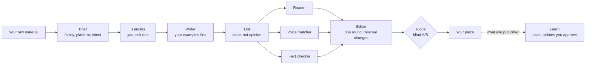
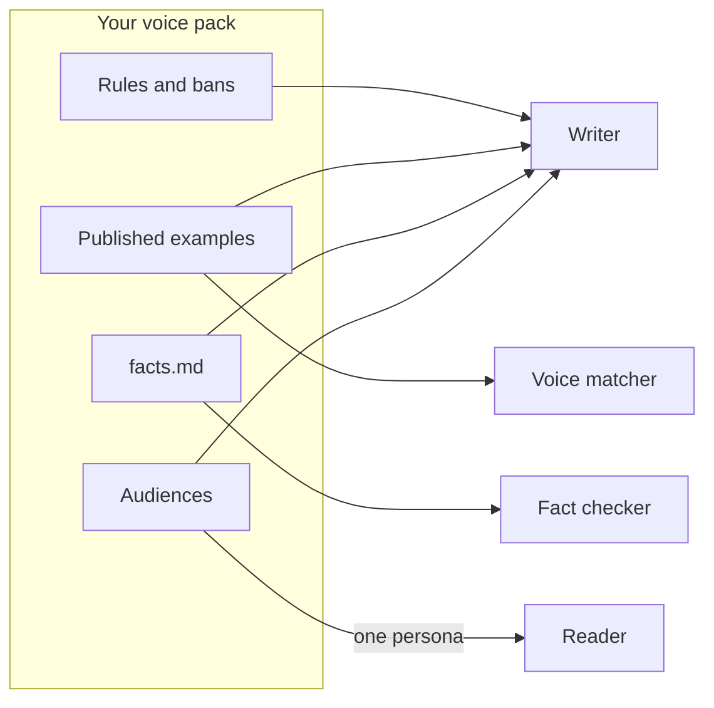
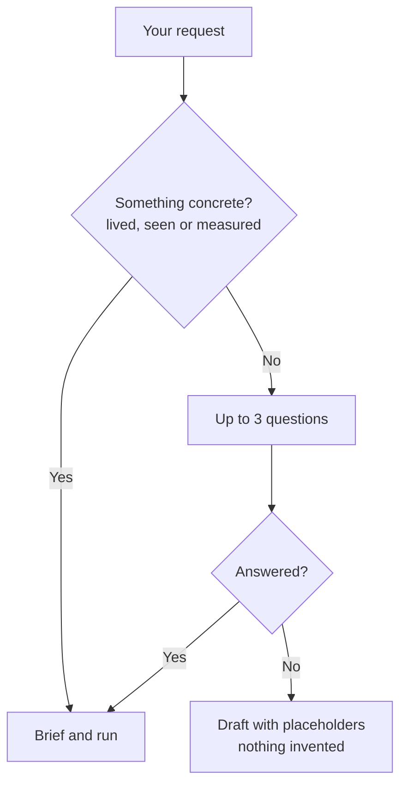
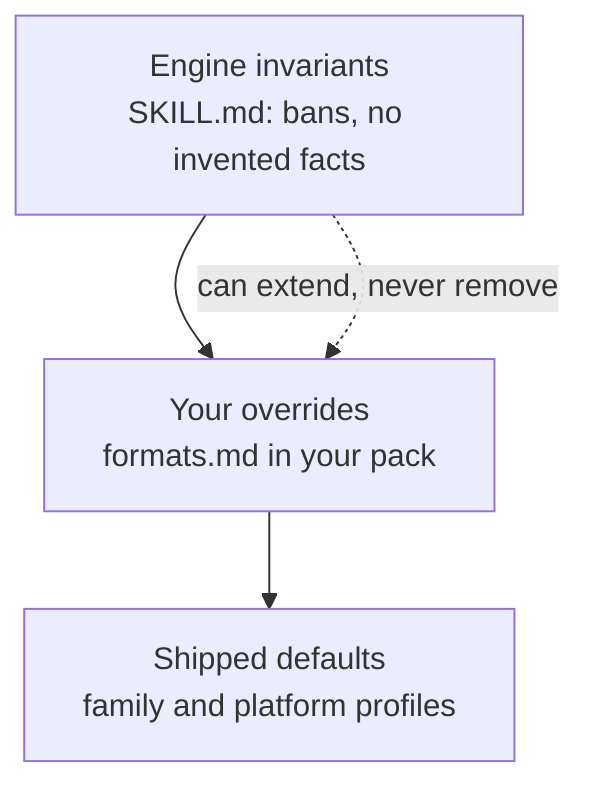
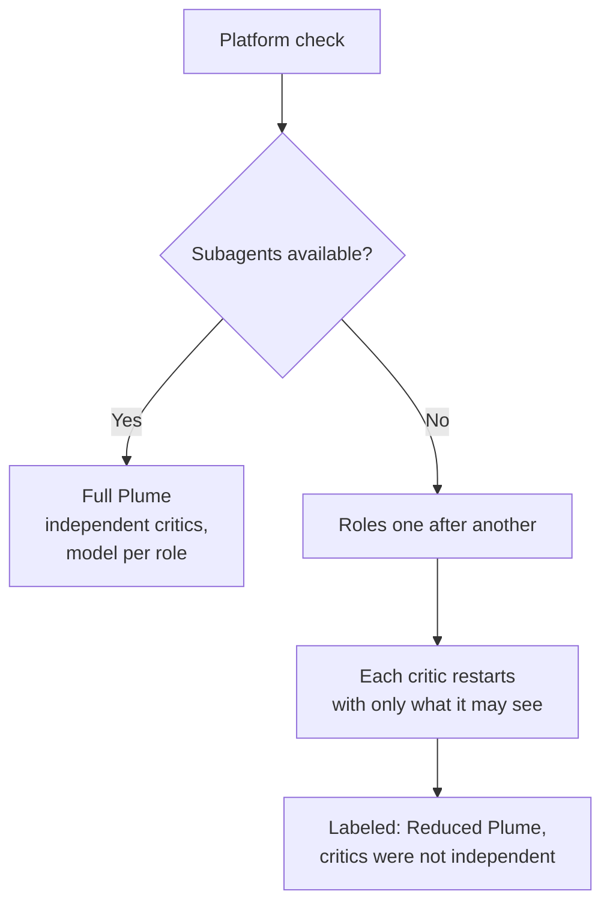
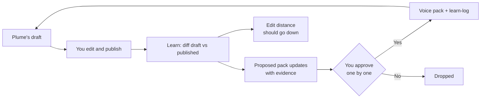

# Plume identity brief

Everything needed to design Plume's logo, visuals, diagrams and landing page. Source of truth: `SKILL.md` v0.2. Sister brief: Prism's `docs/identity.md`.

## 1. Name and taglines

- **Name:** Plume, everywhere (product, skill, plugin, ZIP)
- **Repo:** `skill-plume`
- **Tagline (skill, directories, repo):** Writes like you. Reads like your audience.
- **Tagline (landing page), proposed:** The writing desk for people who publish under their own name.
- **Claude Code commands:** `/plume` (Plume picks the mode), or `/plume:write`, `/plume:edit`, `/plume:repurpose`, `/plume:review`, `/plume:learn`, `/plume:setup`
- **Other platforms:** `@plume` in ChatGPT desktop, `$plume` in Codex
- **French hook, proposed:** "Prendre la plume sans perdre sa voix."
- **Never in French:** "plumer" as a verb. "Se faire plumer" means getting ripped off.
- **The name:** in French, "prendre la plume" means to start writing, and a "plume" is both a feather and a pen nib. In English it reads as a feather: light, and in your hand.
- **Known collision:** an existing "Plume AI" writing assistant. Accepted. Check trademarks before launch.

## 2. Descriptions

**One line (directories, GitHub "About", social bio)**
A writing assistant that drafts in your voice, then checks it with critics who each miss something on purpose.

**Short (around 40 words, store listings, cards)**
Plume writes, edits and repurposes posts, articles, emails and messages from what you actually published. Three critics test each draft: a reader from your audience, a voice matcher and a fact checker. One revision, then a blind pick of the better version.

**Medium (README intro, landing page hero)**
AI drafts tend to sound like the same person, and that person isn't you. Plume starts from pieces you published, not from a list of rules. It drafts from your raw material, runs code checks for AI tells, then hands the draft to three critics who each lack something the writer has: one never sees your rules, one only sees your published work, one only sees your facts. They catch what a stranger would notice. One round of minimal fixes, a blind comparison keeps the better version, and every time you publish, Plume learns from what you changed.

**What Plume is**
- A writing assistant for one person's voice, or one brand with its own pack
- Built on examples first, rules second
- Honest about facts: missing figures become placeholders, never inventions
- Measured: edit distance to publish should go down over time

**What Plume is not**
- A content generator that writes from nothing
- A tool that changes your voice per platform
- An engagement-bait machine
- A translator, a designer, or a scheduler that posts for you

## 3. The cast

The idea that sets Plume apart: **each critic is defined by what it can't see.** A critic with the writer's full context shares the writer's blind spots.

### The angle finders

Three in parallel, each with one lens, none sees the others:
- **What it costs:** the price of the problem, in time, money or nerves
- **What it contradicts:** the common belief the material pushes against
- **The lived moment:** the scene, the day, the sentence someone said

You pick one angle. Skipped when the intent doesn't need it (a reply, a short message).

### The writer

- Role: drafts the piece
- Sees: your raw material, 3 to 5 published pieces of the same family and language, then your voice pack and the format rules
- Particularity: examples come first. Rules produce compliant, generic text.

### The lint

Not an agent: a script. Banned characters and phrases, AI tells ("not X, it's Y", generic openers, reflex questions), rhythm uniformity, lists of three, paragraph length, Markdown where the platform doesn't render it, hashtag and link counts. Its result wins on mechanical points.

### The three critics

- **The Reader**
  - Role: one specific person from your audiences, in their real situation (scrolling, searching, swiping)
  - Asks: "Would I stop? Do I get it? What do I do next?"
  - Sees: the piece and one audience persona
  - Never sees: your voice pack, your rules, your intent

- **The Voice matcher**
  - Role: checks that it sounds like the same person
  - Asks: "Which sentence would never appear in what you published?"
  - Sees: the piece and your published examples
  - Never sees: your rules. It judges by ear, not by checklist.

- **The Fact checker**
  - Role: traces every claim
  - Asks: "Where does this come from?"
  - Sees: the piece, your raw material and `facts.md`
  - Never sees: anything else

### Specialists, by format

- **SEO:** articles and pages. Does the title match the query in the reader's words?
- **Slide alone:** slides. Does each slide make sense if it's the only one someone sees?
- **Read aloud:** scripts. Does it survive being spoken?

### The editor and the judge

- **The Editor:** one round of minimal fixes from the critics' findings. In edit mode, the text is yours: only flagged changes plus typos.
- **The Judge:** compares two versions without knowing which one is the revision, and keeps the better one. If it prefers your original in edit mode, Plume returns it with suggestions.

### Key numbers

- 7 modes: write, edit, repurpose, review, learn, setup, add-format
- 8 families: post, article, email, message, comment, slides, script, page
- 7 platforms: LinkedIn, Reddit, Slack, Teams, WhatsApp, blog, email
- 6 intents: inform, convince, ask, announce, reply, relationship
- 3 angles, 3 critics, 1 revision round, 1 blind pick
- 1 call to action at most
- Up to 3 questions when the raw material is missing

## 4. Visual concept

**The metaphor: the draft and the margin.** A page of your writing, and in the margin, notes from readers who each see only part of the picture. The lint is a highlighter, the critics are margin notes, the editor is a small strike-through, the judge is a choice between two pages. Prism's story is "in, split, recombine". Plume's story is **write, mark, keep**.

Avoid the literal quill: it's the first image anyone would pick, it looks old, and it says "calligraphy" more than "publishing on LinkedIn".

**Link with goua.la.** The goua.la logo uses four shapes: circle, square, triangle, cross. Prism took the triangle. Two candidates for Plume:
- **The circle (recommended):** the ink dot, the full stop at the end of a sentence you'd publish. Simple, and it leaves the cross for a future product.
- **The cross:** the editor's mark. Strong for the critics, but it reads as "wrong" or "delete", which is the opposite of the promise.

**Logo directions**
- **A. Dot and stroke:** the goua.la circle with one thin, tapering stroke leaving it, like a nib's first line. Best for the hero and README header.
- **B. Dot only:** a plain circle, maybe with a small notch for the nib slit. Works at favicon size (16 to 32 px).
- **C. Wordmark:** "plume" in lowercase, like goua.la and prism, with the circle as the full stop: "plume."

Use A for large formats, B for icons and avatars, C for headers.

**Color mapping**
Plume is mostly monochrome: your text is the subject, in white on #191919. Color appears only on marks, like a reviewer's pens. Using the goua.la design system status colors:

- Lint flags: yellow #FFBA49 (the highlighter)
- The Reader: teal #34BEAE (the outside view)
- The Voice matcher: purple #9045CF (your voice, the brand color, rationed)
- The Fact checker: red #FF5E5E (a claim that can't be traced)
- Writer, editor, judge: white and grey (they write, they don't mark)
- Placeholders: dashed grey outline, like a blank to fill in

**Typography and background**
- Satoshi for titles, Inter for body, as goua.la's current design system
- Dark background #191919 by default
- Text samples in the demo use the same body font as the site, so the draft reads like a real post, not a code block

## 5. Diagrams

All diagrams in Mermaid. GitHub renders them directly in README files.

### 5.1 Overview: a write run

### 5.2 Who sees what

### 5.3 The raw material gate

### 5.4 Three layers of format rules

### 5.5 Full mode vs reduced mode

### 5.6 The learning loop

## 6. Landing page

Decisions are in `CLAUDE.md` under "Landing page". For design, the two moments to show:
- **The blind-spots grid** (diagram 5.2 as a visual): who sees what
- **The marked draft:** one real post where the lint highlights appear, then the three critics' margin notes, then the editor's strike-throughs, then the judge's pick between two versions

Proof comes from the owner's real runs only: generic AI draft, Plume draft and published version side by side, with the edit distance.
